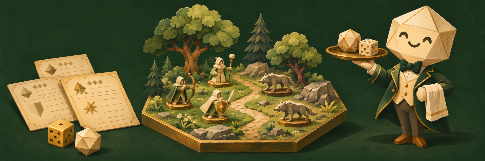
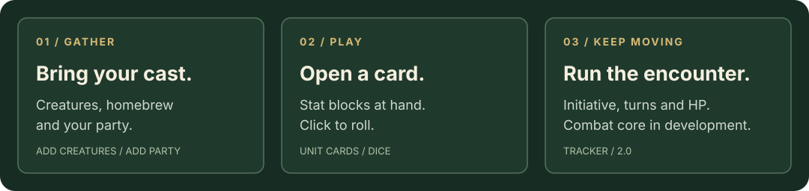

# Encounter Butler

### Set the scene. Serve the rolls. Keep combat moving.

A combat assistant for [Owlbear Rodeo](https://www.owlbear.rodeo): bring in creatures and your party, open their stat cards, and roll straight from the action. Built for D&D 5.5E (2024), with a 5E (2014) setting.

**[Install](#install-in-owlbear-rodeo)** · **[How to play](docs/USAGE.md)** · **[Roadmap](docs/ROADMAP.md)** · **[Developer guide](docs/DEVELOPMENT.md)**

> **2.0 is in development.** This page describes `main`, where Butler works independently of Forge! The hosted version may differ. See the [changelog](CHANGELOG.md) and [releases](https://github.com/corrida-repos/owlbear-rodeo-butler/releases) for release history; the [roadmap](docs/ROADMAP.md) tracks remaining work and live validation.

## Your encounter, at hand

**Bring the cast.** Search published creatures from 5etools, build a homebrew unit, or sync your D&D Beyond campaign. Add one wolf or a whole pack, with individual HP and initiative. D&D Beyond is optional; sidekicks and party members can be added directly.

**Play from the card.** Each token carries its stat block. Open a unit card for abilities, attacks, spells and clickable dice. Roll with advantage or disadvantage, follow an attack with damage, and choose public or private results.

**Keep the table together.** Give players control of their units so they can open their own cards. Use the difficulty calculator to assess the opposition. The developing combat tracker brings turns, rounds and HP into the same extension.

<picture>
  <source media="(max-width: 600px)" srcset="docs/assets/encounter-flow-mobile.svg">
  
</picture>

### What works, and what's next

| Area | Status in `main` |
|---|---|
| Creatures & party | Published creatures, homebrew, quantities, rolled HP, D&D Beyond party sync and prepared encounter imports. |
| Cards & dice | Native stat blocks, clickable rolls, advantage/disadvantage, critical damage, public/private rolls and a session log. |
| Unit identity | Portraits, names, aliases and controlling players. Players can open their own cards. |
| Combat core | Tracker, turn controls, rounds, HP/temp HP, death saves, Stable, Dead and turn notices. Phase 3 is complete and live-checked; see the roadmap for validation details. |
| Still ahead | Condition durations, movement tracking, the full player tracker, player self-sync, a saved creature collection, richer search filters and completion of the edition-specific rules. |

The goal is one extension for a whole encounter. See the [2.0 roadmap](docs/ROADMAP.md) for scope and acceptance criteria.

## Install in Owlbear Rodeo

You need an Owlbear Rodeo account and a room where you are the **GM**. Players do not need to install anything separately.

1. On the Owlbear home page, open **Profile → Extensions → Add Custom Extension** and paste:

   ```text
   https://corrida-repos.github.io/owlbear-rodeo-butler/manifest.json
   ```

2. Open your room, click **Extensions** (the puzzle piece), and enable **Encounter Butler**.
3. Open Butler from the room toolbar. In **Combat → Game system**, choose your edition. **D&D 5.5E (2024)** is the default.

The hosted extension updates without a download or reinstall.

**Coming from Forge?** Butler 2.0 uses its own token data. Existing Forge units are not converted; add them again through Butler.

## Start with one small encounter

1. **Add Creatures:** search for a creature, put it on the list, set a quantity and add it to the scene.
2. **Add Party:** add characters or companions directly, or use **Sync from D&D Beyond**. The sync needs a one-time bookmark setup in a desktop browser and access to the campaign you DM.
3. **Open a card:** right-click a Butler token → **View unit card**. Click a roll; hold **Shift** for advantage or **Ctrl/Cmd** for disadvantage.
4. **In the developing 2.0 tracker:** roll initiative, press **Start combat**, and move through turns. Enter `-7` for damage, `+5` for healing or `t5` for temporary HP.

The [player guide](docs/USAGE.md) covers homebrew, party sync, combat controls, player access and troubleshooting. To package a map with positioned creatures, follow the [prepared encounter workflow](docs/DEVELOPMENT.md#new-encounter-workflow).

## Your table's data

Butler has no separate account, subscription or application backend. Unit sheets and combat state live in Owlbear token and scene metadata. D&D Beyond sync reads sheets in your logged-in browser and sends the export back to the extension, with clipboard fallback; your login credentials stay in that tab.

Creature data and art load from public 5etools repositories on GitHub. D&D Beyond portraits use the [wsrv.nl](https://wsrv.nl) image proxy. See [privacy and limitations](docs/USAGE.md#privacy) for details. Token metadata is readable by technically savvy players, so card visibility does not secure hidden stat blocks.

**Current limits:** square grids; no automatic active-spell AC adjustments or combined multiclass spell slots. The 2014 rules setting is still being completed. Butler is a combat companion, not a full character-sheet replacement.

## Build with us

Found a rough edge? [Report a bug or suggest a feature](https://github.com/corrida-repos/owlbear-rodeo-butler/issues). Include your rules edition, what you expected, and what happened. Avoid posting private character exports.

For local development, use Node.js (CI uses **22**) and npm:

```bash
npm ci
npm test
npm run build
npm run dev
```

The extension is served under `/owlbear-rodeo-butler/`. Architecture, local installation in Owlbear, encounter tooling and validation notes are in the [developer guide](docs/DEVELOPMENT.md).

---

Encounter Butler is an unofficial fan project, not affiliated with or endorsed by Owlbear Rodeo, D&D Beyond or Wizards of the Coast. The banner is AI-generated brand artwork, not a screenshot of the extension.
